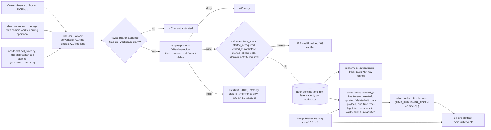

# 01 — Business process (As-Is / To-Be)

life-time-api คือ cell "Time tracking" ที่บันทึกเวลาของ owner สองแบบ: time entry (เริ่ม, จบ, ระยะเวลา ต่อ task หนึ่งตัว) และ time log (วัน, domain, กิจกรรม, นาที) ที่ check-in worker เขียน owner และ automation เรียกผ่าน API ด้วย token ของ empire-platform; time log ถูกส่งเข้า graph เป็น node เปล่าพร้อม set event `in-domain` ส่วน time entry ไม่ส่ง event

Last reviewed: 2026-11-27 · commit `4ff4df2`

## As-Is (จากโค้ดวันนี้)

Sources: `cell.yaml`, `migrations/0002_catalog_backfill.sql`, `.railway/railway.ts`, `pyproject.toml` (platform-cellkit v1.1.13: `cellkit/app.py` `emit`, `cellkit/auth.py`, `cellkit/publisher.py`, `cellkit/server.py`), `README.md`, `PRODUCT.md`

ข้อเท็จจริงสำคัญจากโค้ด:

- `time-log` มี `graph: []` (payload ไม่มี domain, วันที่ หรือนาที มีแค่ `version` และ `deleted`) และ `catalog.in-domain` map `work`→`work`, `learning`→`skills`, `personal`→`unclassified`, ค่าอื่น→`unclassified`; set event ส่งตอนสร้างและตอนที่ `domain` เปลี่ยนเท่านั้น
- `time-entry` ไม่มี `graph` จึงไม่เขียน outbox; `duration_seconds` เก็บตามที่ส่งมา ไม่ได้คำนวณจากเวลาเริ่ม/จบ และ cell ไม่ตรวจว่า `task_id` มีอยู่ใน task service
- `migrations/0002_catalog_backfill.sql` เติม event `.updated` และ `.linked` ให้ time log ที่มีอยู่ก่อนเปิด producer (platform-empire SPEC-002)
- `/v1/time-logs` ไม่มี filter จึงเรียก stats ไม่ได้; `log_date` เป็น text ไม่ใช่ date
- การสร้างแบบ import (มี `legacy_id`) ต้องมีสิทธิ์ `time.<resource>:admin` เพิ่มจาก `:write`; create รับ `Idempotency-Key`, patch ใช้ `expected_version`
- owner token (ไม่มี delegation) อายุได้ไม่เกิน 1 ชั่วโมง, delegated token ไม่เกิน 30 วัน
- check-in worker เป็นผู้เขียน time log ตามคอมเมนต์ใน `cell.yaml`; ตัว worker อยู่นอก repo นี้ [ต้องยืนยัน]
- การตรวจ `X-Gateway-Assertion` (edge gateway) เปิดตาม `GATEWAY_ASSERTION_MODE`; ค่าใน production [ต้องยืนยัน]

## To-Be (จาก PRODUCT.md §Measures)

ไม่มี spec ที่ค้างอยู่ (`specs/001-l2-baseline` approved และ implement แล้ว) และไม่มีภาพกระบวนการเป้าหมายที่เขียนไว้ สิ่งที่เขียนไว้มีเพียง measures ที่ "Proposed, nothing collects them yet":

- จำนวน time entry ต่อสัปดาห์ และสัดส่วนที่มี `ended_at`
- entry ที่ยังวิ่งอยู่ (ไม่มี `ended_at`) นานกว่า 24 ชั่วโมง
- 5xx rate และ p95 latency ของ `/v1/time-entries` (Sentry และ uptime worker)

## Gap

| ID | As-Is → To-Be | Status | Owner | Evidence |
|---|---|---|---|---|
| G1 | `README.md` และ `PRODUCT.md` ไม่พูดถึง service `time-publisher` (cron `10 * * * *`) และ graph events ของ time log → เอกสารตรงกับโค้ด | todo | claude | `.railway/railway.ts`; `cell.yaml` `time-log.graph` / `catalog`; `README.md`; `PRODUCT.md` §Positioning |
| G2 | measures เป็นแค่ข้อเสนอ ไม่มีอะไรเก็บ (รวม entry ที่ค้างเกิน 24 ชั่วโมง) → owner อนุมัติ measures และเลือกที่เก็บ | decide | owner | `PRODUCT.md` §Measures |
| G3 | ไม่มี To-Be ของกระบวนการ (เช่น timer ที่หยุดเอง, สรุปเวลา) → owner กำหนด | decide | owner | ไม่มีใน `PRODUCT.md` / `specs/` (ทั้งสองอย่างอยู่ใน out of scope) |

## Open questions

- หน้าใน `life-dashboard-web` แสดงเวลาจาก cell นี้หรือไม่ (`PRODUCT.md` ระบุ [ต้องยืนยัน])
